<div align="center">



<p>
  <a href="https://vung24.github.io"></a>
  <a href="mailto:Vung030524@gmail.com"></a>
  <a href="https://play.google.com/store/apps/details?id=com.spear.throwing.aim.hit"></a>
</p>

### Unity / C# developer building mobile games that feel good from the first tap.

</div>

---

## About

I'm **Vung**, a Unity game developer focused on **mobile puzzle and casual games**. I've shipped two titles to Google Play and built a series of puzzle prototypes, each one a chance to get better at the parts players actually feel: input response, animation timing, feedback and flow.

## Shipped on Google Play

| | Game | What I built |
|:-:|---|---|
| 🎯 | **[Spear Master: Aim & Hit](https://play.google.com/store/apps/details?id=com.spear.throwing.aim.hit)** | Spring-powered throwing, aim and timing mechanics, hit feedback and impact effects |
| 🌷 | **[Lovely Blooms: Dot Connect](https://play.google.com/store/apps/details?id=com.lovely.blooms.dot.connect)** | Dot-connect puzzle with numbered paths, blooming floral reveals and level progression |

## Featured Projects

<table>
<tr>
<td colspan="2">

### 🌀 [LoopMaster](https://github.com/Vung24/LoopMaster) &nbsp;`current project`

A path-based puzzle game with board interactions, level progression and boosters. My focus here is a **maintainable gameplay architecture** (systems that can take new mechanics without rewrites) and responsive game feel.

`Unity` `C#` `Gameplay Systems` `Boosters` `Level Progression`

</td>
</tr>
<tr>
<td width="50%" valign="top">

### 🧪 [MagicSort](https://github.com/Vung24/MagicSort)
Color-sort puzzle with tubes and beakers, data-driven level loading, input handling and power-ups.

`Puzzle` `Level Data` `Power-ups`

</td>
<td width="50%" valign="top">

### 🎯 [Match3](https://github.com/Vung24/Match3)
Tray-based matching prototype with win/lose states, multiple game modes and tweened animations.

`Matching` `Game Modes` `DOTween`

</td>
</tr>
<tr>
<td width="50%" valign="top">

### 🍢 [Grill-Sort](https://github.com/Vung24/Grill-Sort)
Food-sorting prototype built on drag-and-drop interactions, grill stations and level generation.

`Drag & Drop` `Level Generation`

</td>
<td width="50%" valign="top">

### 🌸 [MagicBloom](https://github.com/Vung24/MagicBloom)
Liquid-sort puzzle with segmented liquids, pour logic, spawning and a central game manager.

`Puzzle` `Pour Logic` `Spawning`

</td>
</tr>
</table>

<p align="right"><a href="https://github.com/Vung24?tab=repositories">All repositories →</a></p>

## Toolkit

<p>
  
  
  
  
  
  
  
  
  
  
</p>

## How I Work

```
 BUILD  ──▶  PLAYTEST  ──▶  FEEL  ──▶  OPTIMIZE  ──▶  POLISH
   ▲                                                    │
   └────────────────────── iterate ─────────────────────┘
```

Start from one mechanic, get it in players' hands fast, then tune until every tap has a clear response. Keep the code clean enough that the next feature is easy to add.

## GitHub Activity

<div align="center">
  
  
</div>

---

<div align="center">

**Building, playtesting and polishing, one game at a time.**

[Portfolio](https://vung24.github.io) · [Email](mailto:Vung030524@gmail.com) · [Google Play](https://play.google.com/store/apps/details?id=com.lovely.blooms.dot.connect)

</div>
