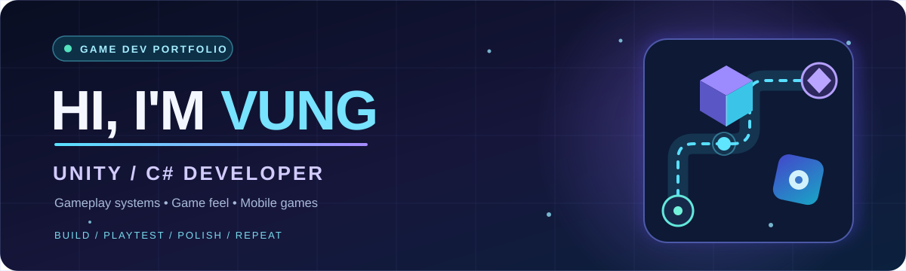

**I build gameplay that feels good to play — from the first tap to the final polish.**

## 👋 About Me

I'm **Vung**, a **Unity / C# Game Developer** focused on building engaging mobile games, responsive gameplay systems, and polished player experiences.

- 🕹️ **I build:** gameplay loops, UI interactions, level systems, and player feedback.
- ⚙️ **I work with:** Unity, C#, DOTween, Addressables, object pooling, and optimization.
- 📱 **I integrate:** Firebase, analytics events, IAP, and third-party mobile SDKs.
- 🌱 **I'm exploring:** game architecture, performance, game feel, and playable ads.
- 🤝 **I'm open to:** collaborating on Unity games and interesting gameplay ideas.

## 🧰 Tech Stack

**Engine & Development**

**Gameplay & UI**

**Mobile & Services**

---

## 📱 Published Mobile Games

<table>
<tr>
<td width="50%" valign="top">
<h3>🎯 Spear Master: Aim &amp; Hit</h3>

<i>Spring Spear project</i>

A mobile action game built around aiming, timing, spring-powered throws, and satisfying impact feedback.

</td>
<td width="50%" valign="top">
<h3>🌷 Lovely Blooms: Dot Connect</h3>

<i>Dot Puzzle project</i>

A relaxing mobile puzzle game about connecting numbered dots to complete blooming floral shapes.

</td>
</tr>
</table>

---

## 🎮 Featured Projects

> A selection of public Unity projects and gameplay prototypes. **LoopMaster** is my most recently updated project.

<table>
<tr><td width="100%" valign="top">
<h3>🌀 <a href="https://github.com/Vung24/LoopMaster">LoopMaster</a> &nbsp; </h3>

<strong>My latest Unity puzzle game project.</strong> Built around path-based gameplay, board interactions, level progression, boosters, and responsive game feel. I focus on maintainable gameplay systems and polishing the player experience.

   

<a href="https://github.com/Vung24/LoopMaster"><b>Explore LoopMaster →</b></a>
</td></tr>
</table>
<table>
<tr>
<td width="50%" valign="top">
<h3><a href="https://github.com/Vung24/MagicSort">🧪 MagicSort</a></h3>

A color-sorting puzzle project featuring tubes, beakers, level loading, input handling, and power-ups.

  

<a href="https://github.com/Vung24/MagicSort"><b>View repository →</b></a>
</td>
<td width="50%" valign="top">
<h3><a href="https://github.com/Vung24/Match3">🎯 Match3</a></h3>

A tray-based matching prototype with animations, win/lose states, and multiple gameplay modes.

  

<a href="https://github.com/Vung24/Match3"><b>View repository →</b></a>
</td>
</tr>
<tr>
<td width="50%" valign="top">
<h3><a href="https://github.com/Vung24/Grill-Sort">🍢 Grill-Sort</a></h3>

A food-sorting prototype built around drag-and-drop interactions, grill stations, and level generation.

  

<a href="https://github.com/Vung24/Grill-Sort"><b>View repository →</b></a>
</td>
<td width="50%" valign="top">
<h3><a href="https://github.com/Vung24/MagicBloom">🌸 MagicBloom</a></h3>

A liquid-sorting puzzle prototype with tubes, liquid segments, spawning, and gameplay management.

  

<a href="https://github.com/Vung24/MagicBloom"><b>View repository →</b></a>
</td>
</tr>
</table>

<a href="https://github.com/Vung24?tab=repositories"><b>Explore all repositories →</b></a>

---

## ✨ How I Approach Games

`BUILD` → `PLAYTEST` → `FEEL` → `OPTIMIZE` → `POLISH`

I enjoy turning a simple mechanic into a complete, responsive experience — with clean code, clear feedback, and attention to the small details players notice.

## 📫 Let's Connect

- **GitHub:** [@Vung24](https://github.com/Vung24)
- **Email:** [Vung030524@gmail.com](mailto:Vung030524@gmail.com)
- **Phone:** 0397157544

---

**🎮 Always learning, building, and improving one game at a time.**

